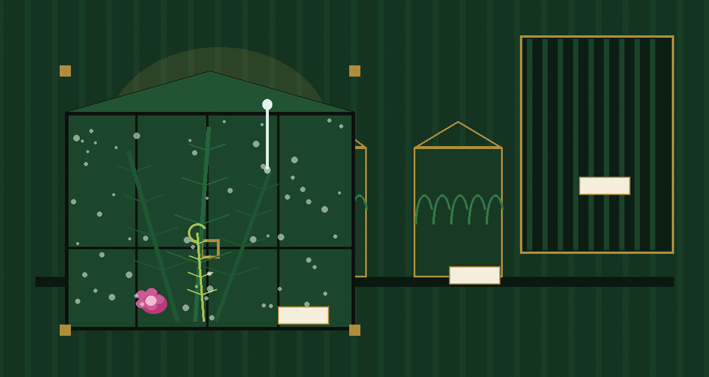
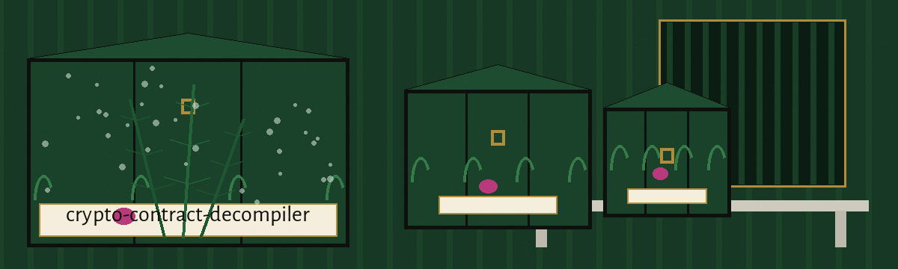

# crypto-contract-decompiler

Title block: the name above is set in Big Shoulders Stencil Display SC in canopy green on a cream specimen card, ruled beneath, with one small Wardian case plate beside this first heading only.

# crypto-contract-decompiler
Reads a contract bytecode or source text file and writes a short report
listing which of four cryptographic operation names (keccak256, sha256,
ripemd160, modexp) appear as text in it. It does not disassemble or
decompile anything, and it uses no external decompiler; the report
itself labels this a placeholder analysis. A missing input file exits 1.

> Catalogue caution: the report begins by copying the whole input file into itself, so a shared report carries the contract text with it.

## Install
`git clone https://github.com/ShadowGuard-AI/crypto-contract-decompiler`

> Catalogue caution: the default output path is output.txt in the caller's directory, and a second run from the same place replaces the first report without warning.

## Usage
`python3 main.py BYTECODE_FILE`

> Catalogue caution: genuine compiled bytecode, being hex digits and opcode bytes rather than written names, returns an empty list even where the running contract uses all four operations.

## Parameters
- `BYTECODE_FILE`: Path to the bytecode file of the smart contract.
- `-h`: Show help message and exit
- `--output_file`, `-o`: Path to save the decompiled/analyzed output. Default: `output.txt`.
- `--debug`: Enable debug logging.

> Catalogue caution: findings do not change the exit rule. A completed report exits 0 whether its list holds four names, one name, or none.

## License
Licensed under the terms in LICENSE.

## Facts from the code, stated in the prose

This record names: keccak256, sha256, ripemd160, modexp, output.txt, BYTECODE_FILE, --output_file, --debug, python3 main.py BYTECODE_FILE, git clone https://github.com/ShadowGuard-AI/crypto-contract-decompiler, Licensed under the terms in LICENSE, MIT License, placeholder analysis, List the Four Operation Names, Four Names, Looked For as Text, Choose Where the Report Is Saved, Turn On Debug Logging, Show Help, A Report That Contains Its Input, No Disassembly, No Decompilation, An Empty List Is Still a Finished Run.
